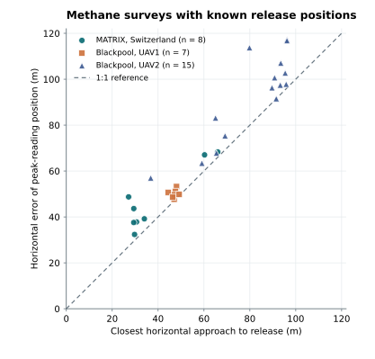

# PlumeNav code review and real-flight validation

We replayed 40 physical flights from three independent studies. Each study supplied both the recorded sensor trajectory and the reference release coordinates. The replay supplied recorded sensor readings, poses, the public search domain and the wind information used by each method. We used the release coordinates afterwards to score horizontal error. Aircraft in the original studies followed their own missions. This experiment tests PlumeNav's estimates on those recorded paths.

| Study and evaluated task | Flights | Median horizontal error | Outcome |
| --- | ---: | ---: | --- |
| EPFL ethanol, numerical Infotaxis endpoint on a fixed trajectory | 1 calibration + 9 search | 0.399 m | Nine endpoints within 1 m. Eight flights had a positive encounter and supplied a gas-supported estimate. No source declarations. |
| EPFL ethanol, strongest gas reading on the identical 1 Hz search inputs | Same 9 search flights | 0.551 m | Six peak locations within 1 m. |
| Swiss MATRIX methane, peak estimate on downwind survey planes | 8 | 41.40 m | Range 32.36–68.31 m. These eight files explicitly label the source. |
| UK Blackpool methane, peak estimate on two UAVs’ downwind tracks | 22 | 79.22 m | Range 47.70–117.23 m. The nearest sampled point lay a median 67.33 m from the release. |

The default tunnel replay freezes a 212.4 mV threshold using the upstream portion of one reserved commissioning flight. It then processes the nine other flights using only their measurements as they arrive. Across the eight flights with an encounter, the median Infotaxis error was 0.421 m and the median matched peak error was 0.609 m. Flight 6 supplied zero hits. Its numerical endpoint was 0.228 m from truth even when all gas detections were removed. This illustrates why a model-only endpoint is kept distinct from a gas-supported estimate. The earlier retrospective ten-flight protocol remains reproducible with `--legacy-retrospective`. [Protocol, all-miss control and individual errors](robot-field-replay.md)

The outdoor replays now also combine an observed methane crossing with independent wind data. Thirteen UK surveys and one Swiss survey produced an upwind bearing. The median perpendicular miss was 4.69 m for the thirteen UK results. The single Swiss bearing missed by 29.80 m. The other sixteen surveys yielded explicit abstentions. These figures measure transverse error with unknown source range. [Per-flight eligibility, controls and errors](outdoor-wind-bearings.md)

## What the outdoor surveys test

The coverage estimator reports the position of its highest gas reading. Its minimum possible horizontal error on a given recorded flight is therefore the distance from the release to the nearest sampled position. The diagonal shows this geometric limit. The vertical distance above it shows the additional error from which reading the estimator selected. Every point is one survey. The aircraft flew these transects for emission-rate quantification. The plotted errors apply to the peak estimator. The outdoor experiments reported here do not evaluate Infotaxis or emissions quantification. [Swiss survey results](methane-field-matrix.md)



[Flight data used for the figure](field-validation-figure/survey-distances.csv) · [PDF](field-validation-figure/survey-distances.pdf) · [Editable SVG](field-validation-figure/survey-distances.svg) · [Python plotting script](field-validation-figure/plot.py)

### Blackpool replay

Shah and colleagues released methane outdoors at known locations in Lancashire. We used all seven UAV1 surveys and all fifteen UAV2 surveys in their archive. Their analysed MATLAB files contain absolute GPS, corrected mole fractions and aligned sample times. The extraction checks that the ppm channel agrees with the independently stored mole fraction to a factor of one million. It preserves the authors’ sampling windows and instrument-specific timing corrections. It excludes fitted plume coordinates and source-relative positions from controller inputs. The study supplement identifies the controlled releases in Tables S1–S3. [Dataset](https://doi.org/10.5281/zenodo.3708518) · [Study](https://doi.org/10.5194/amt-13-1467-2020) · [Supplement](https://amt.copernicus.org/articles/13/1467/2020/amt-13-1467-2020-supplement.pdf)

| Aircraft | Surveys | Aligned readings | Median peak-to-source distance | Range |
| --- | ---: | ---: | ---: | ---: |
| UAV1, ground analyser with sampling tube | 7 | 36,892 | 49.83 m | 47.70–53.23 m |
| UAV2, onboard analyser | 15 | 40,243 | 97.44 m | 56.98–117.23 m |

The two aircraft sampled different tracks. These figures cannot rank the two instruments. A separate NumPy calculation recovered the same peak coordinates on all 22 flights. The reported distances use a mean-radius Earth. A local WGS84 surface-chord check differed by at most 0.37 m over these distances.

## Code review findings

| Finding | Reproduction and correction |
| --- | --- |
| Robot advanced beyond an off-grid mission deadline | With 0.25 s control ticks, a 0.4 s mission at 0.1 m/s travelled 0.050 m. The engine now clips the final translation and turn to the time remaining and gives that interval to the controller. The regression returns 0.040 m. |
| EPA replay accepted edited measurements under the official workbook digest | Changing one extracted methane reading to 885.3 ppm preserved the claimed workbook checksum and changed the reported peak. The replay now fingerprints the decoded observation rows as well as checking the workbook identifier. The edited input is rejected and the authentic result reproduces exactly. |
| A peak on a downwind track can be far from the leak | The UK and Swiss replays quantify this behaviour with real release positions. A peak remains a position to investigate. The mapped-fitting policy now measures upwind and both crosswind flanks before issuing a reinspection flag. |

The four-inlet fitting decision needs repeated settled fitting readings, wind-aligned spatial controls and channel-level clipping flags. None of these external flights supplied that observation sequence. The Birmingham backpack still needs a synchronised replay with its own calibration, inlet poses, wind and a surveyed release plus blanks to evaluate that policy and its false-alarm rate.

## Reproduce

Install the locked dependencies with `pnpm install --frozen-lockfile`. The UK reader uses Python 3.11+ with NumPy and SciPy. Set `PYTHON` to its executable if needed.

```sh
curl -fL 'https://zenodo.org/records/3708518/files/Testing%20Data.zip' -o blackpool.zip
pnpm exec vite-node scripts/blackpool-field-replay.ts blackpool.zip
```

The reader verifies the archive SHA-256 before extraction. The command prints the row count, peak coordinates and ppm, reference coordinates, closest sampled distance and horizontal error for each flight. The EPFL and MATRIX pages give their download, verification and replay commands. `pnpm test` runs the application tests. `pnpm test:commissioning` includes measured-peak and EPA integrity regressions. The original repository also has archived research tests requiring files outside this source checkout. [EPFL instructions](robot-field-replay.md) · [MATRIX instructions](methane-field-matrix.md)
